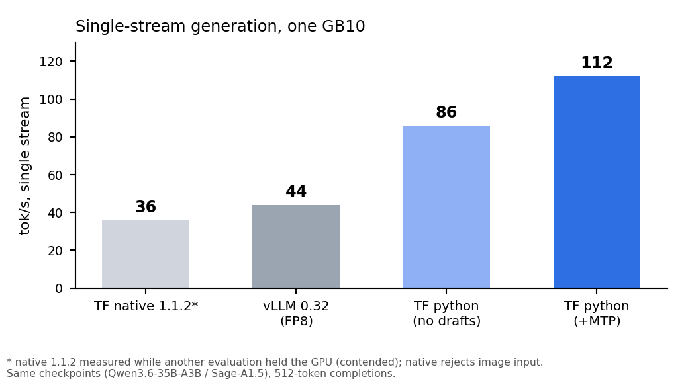

# dgx-spark-qwen-moe

Run **Qwen3.6-35B-A3B** or **Sage-A1.5** on a DGX Spark (GB10) with image input and MTP drafting.

## Effect

The stock TensorFold Python engine serves the `qwen3_5_moe` family on CUDA but has no image path for it;
vLLM serves images but is 2.5× slower per stream. This repo is the TensorFold engine with the vision patch
applied: single-stream generation goes from 44 tok/s (vLLM FP8) to 112 tok/s with MTP drafting, an agentic RAG
loop drops from 90 s to 49 s per question, and images are read correctly (text in a picture answered in 2.2 s).



## Models

| Model | Weights | Size |
|---|---|---|
| Qwen3.6-35B-A3B (4-bit, ships the MTP head) | https://huggingface.co/TensorFold/Qwen3.6-35B-A3B-MLX-4bit-MTP | 20.9 GB |
| Sage-A1.5 (4-bit) | https://huggingface.co/Duckets/Sage-A1.5-MLX-4bit | 20.4 GB |

The MTP drafter is not a separate download: it is a 475 MB `mtp-4bit.safetensors` that ships inside the
Qwen3.6 repository (step 3 downloads that single file, 475 MB — no need for the full 20.9 GB checkpoint). The
two heads correlate 0.98–0.99 after dequantization, which is why the Qwen3.6 file drafts for Sage-A1.5 as well.

## Usage

```bash
# 1. image (the engine ships in src/tensorfold)
docker pull nvcr.io/nvidia/pytorch:26.07-py3
cat > Dockerfile <<'DOCKER'
FROM nvcr.io/nvidia/pytorch:26.07-py3
COPY src/tensorfold /usr/local/lib/python3.12/dist-packages/tensorfold
RUN pip install --no-cache-dir huggingface_hub tokenizers safetensors anyio click filelock fsspec
ENV TENSORFOLD_NO_UPDATE_CHECK=1
DOCKER
docker build -t dgx-spark-tensorfold:0.6.2-moe-vision .

# 2. weights (mainland China: export HF_ENDPOINT=https://hf-mirror.com)
hf download Duckets/Sage-A1.5-MLX-4bit --local-dir /models/Sage-A1.5-MLX-4bit
hf download TensorFold/Qwen3.6-35B-A3B-MLX-4bit-MTP --local-dir /models/Qwen3.6-35B-A3B-MLX-4bit-MTP

# 3. two fixes the conversions need: stop tokens + the MTP drafter
python3 - <<'PY'
import json; p="/models/Sage-A1.5-MLX-4bit/generation_config.json"
c=json.load(open(p)); c.update(bos_token_id=248044, eos_token_id=[248046,248044], pad_token_id=248044)
json.dump(c, open(p,"w"), indent=2)
PY
# the MTP drafter: one 475 MB file, taken from the Qwen3.6 repository
curl -L -o /models/Sage-A1.5-MLX-4bit/mtp-4bit.safetensors https://huggingface.co/TensorFold/Qwen3.6-35B-A3B-MLX-4bit-MTP/resolve/main/mtp-4bit.safetensors
# mainland China mirror:
curl -L -o /models/Sage-A1.5-MLX-4bit/mtp-4bit.safetensors https://hf-mirror.com/TensorFold/Qwen3.6-35B-A3B-MLX-4bit-MTP/resolve/main/mtp-4bit.safetensors

# 4. serve
docker run -d --name sage --gpus all --network host --ipc host \
  -v /models:/models:ro -v /cache:/root/.cache \
  -e TENSORFOLD_NO_UPDATE_CHECK=1 dgx-spark-tensorfold:0.6.2-moe-vision \
  tensorfold serve /models/Sage-A1.5-MLX-4bit --name sage-a1.5 --host 0.0.0.0 --port 18892 \
    --parallel 8 --kv-dtype bf16 --no-thinking --vision --vision-max-images 4 \
    --context 126976 --prompt-cache-gib 8
```

Verify: `curl -s localhost:18892/v1/models`, then a chat completion; images go in as
`{"type":"image_url","image_url":{"url":"data:image/png;base64,..."}}`.

Notes: 126976 is the context that fits with a second 35B model resident; `--no-drafts` runs without the MTP
head; the native 1.1.2 build is faster to start but rejects image input and measured 36 tok/s under load, so it
does not replace this path yet.

## Credits

Based on **TensorFold v0.6.5** (Python engine, frozen upstream at 0.6.6), Apache-2.0. Changes in `src/tensorfold`:
the `qwen3_5_moe` vision patch on CUDA — encoder/processing wiring plus `--vision` in `serve_options.py` and the
`families/qwen3_5_moe` decode/graph paths — and the deployment recipe that goes with it (checkpoint fixes,
context budgeting, two-model layout). Unofficial; not endorsed by the TensorFold authors.

## License

Apache-2.0, see [LICENSE](LICENSE) and [NOTICE](NOTICE).
